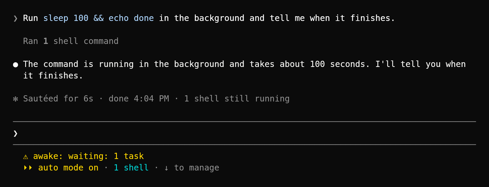
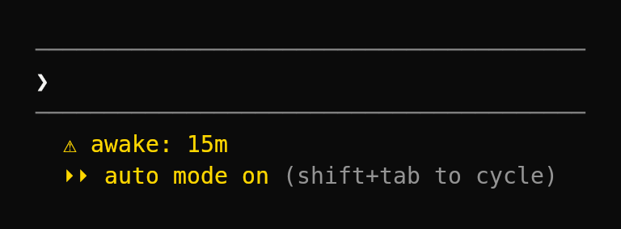
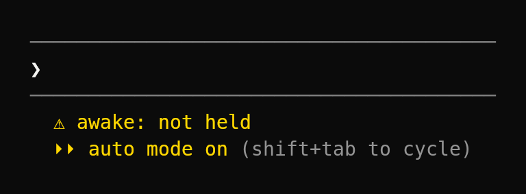

<h1 align="center">awake</h1>

<p align="center">
  <strong>Your computer stays awake while the agent works</strong>
</p>

<p align="center">
  A Claude Code plugin. The computer does not sleep while the agent runs a turn, a command<br>
  or a build in the background, and your sleep settings return 15 minutes after it goes quiet.<br>
  A line under the prompt shows how long that is.
</p>

<p align="center">
  <a href="#install">Install</a> ·
  <a href="#what-it-does">What it does</a> ·
  <a href="#settings">Settings</a> ·
  <a href="CHANGELOG.md">Changelog</a>
</p>

<p align="center">
  
</p>

<p align="center">
  <a href="assets/held-dark.png"></a>
  <a href="assets/not-held-dark.png"></a>
</p>

You start a long task, walk away, and the laptop goes to sleep halfway through the build. I used to
run `caffeinate -dims -t 20000` in a spare terminal before such tasks and then forget to stop it.
awake starts and stops the hold itself, going by what the agent does.

## Install

In Claude Code:

```bash
claude plugin marketplace add localixai/awake
claude plugin install awake@awake
```

The same folder is also an [Agent Plugins](https://agent-plugins.org) package (`plugin.json` and
`hooks.json` at the root), so a client of the core loads it as it is.

It runs on macOS and Linux and needs `node` 20 or later on the `PATH` the agent's hooks see. On
Linux it holds through `systemd-inhibit`, which works from a desktop session.

## What it does

Every prompt, tool call, tool result, subagent, compaction and answer counts as work. The computer
stays awake until 15 minutes after the last one, then the hold ends and the system's own sleep
settings apply again. The plugin reads nothing in the event and sends nothing back to the agent.

All your agents share one hold, so ten sessions in three clients start one background process. On
each tool call the hook runs a short shell script that updates a file's time.

Some work sends no event for a long time. In Claude Code the plugin also counts it as work: a model
turn still running, a tool call that takes long, and background work the agent waits on after it
answered, such as a build started with `run_in_background`, a background subagent or a monitor.
While any of these lasts, the plugin marks the activity once a minute. It writes nothing but that
one file in its own folder, starts no process, and stops when the session ends. Waiting for you,
on a permission prompt or a question, does not count.

## How it holds

One small process per user, the keeper, holds the computer awake while it runs:

| System | Hold |
| --- | --- |
| macOS | `caffeinate -dims -w <keeper>` |
| Linux | `systemd-inhibit --what=idle:sleep`, around a wait for the keeper |

The keeper sleeps on one timer until 15 minutes after the last activity. When it wakes, it checks
the time again. If the agent did something meanwhile, it sleeps until the new end; if not, it exits
and the hold ends with it. A killed keeper takes its hold along, and the next tool call starts a
new one.

## Is it holding now?

In Claude Code the status line under the prompt says so: `awake: 14m` while the computer is held,
with the minutes left; `awake: waiting: 1 task` while it is held for background work; and
`awake: not held` when the system refused the hold. Once no agent has worked for 15 minutes, the
line goes away.

In a shell, or in another client:

```bash
awake status
```

Claude Code puts the plugin's `bin/` on the `PATH` of its shell, so the agent can run it too. The
answer is the keeper's process id and how long the computer stays awake. When nothing holds it, the
answer says why: no agent worked in the last 15 minutes, `node` was not found, or the system
refused the hold (`systemd-inhibit` outside a desktop session says `Access denied`). After a refusal
the plugin waits ten minutes before it tries again. macOS shows the hold in `pmset -g assertions`,
Linux in `systemd-inhibit --list`.

## Settings

Environment variables, in your shell or under `env` in Claude Code's `settings.json`:

| Variable | Default | |
| --- | --- | --- |
| `AWAKE_SECONDS` | `900` | how long the computer stays awake after the last activity |
| `AWAKE` | on | `off` turns it off |
| `AWAKE_CAFFEINATE_FLAGS` | `-dims` | macOS: what `caffeinate` holds; `-ims` lets the display sleep |
| `AWAKE_INHIBIT_WHAT` | `idle:sleep` | Linux: what `systemd-inhibit` holds |
| `AWAKE_DIR` | `localix-awake-<user>` in `$XDG_RUNTIME_DIR` or the temp folder | the shared state and `awake.log` |

## Limits

- In clients other than Claude Code only the hook's events count. A background job that runs
  longer than the window after the agent answered can see the computer fall asleep there; raise
  `AWAKE_SECONDS` for that kind of work.
- A server the agent started in the background and left running counts as background work in
  Claude Code, so it keeps the computer awake; the status line says `waiting: 1 task` while it runs.
- A closed lid on battery puts a Mac to sleep whatever holds it. awake changes no system setting,
  so it does not prevent that.
- Windows is not supported yet: the hook is a POSIX shell script.

## License

MIT
